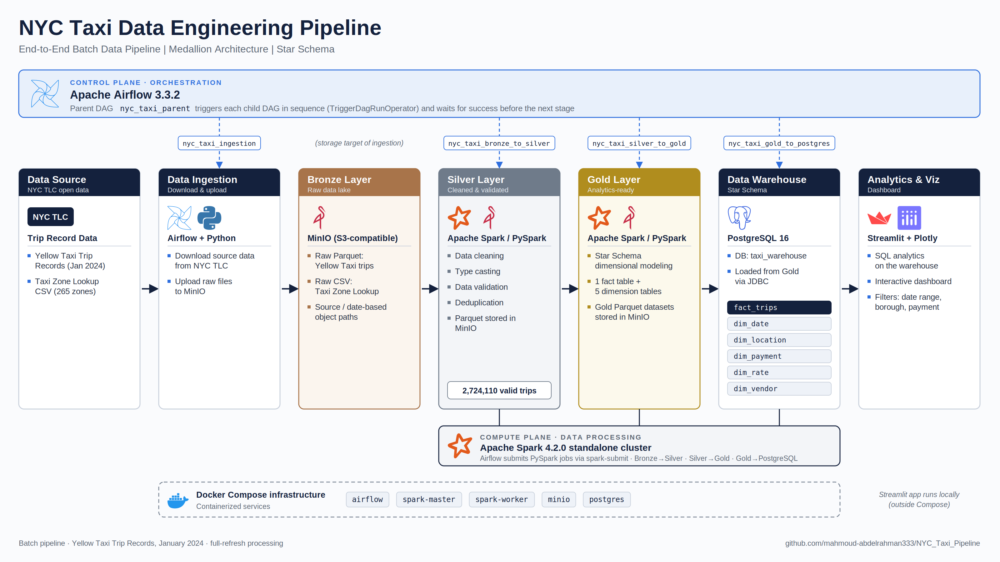
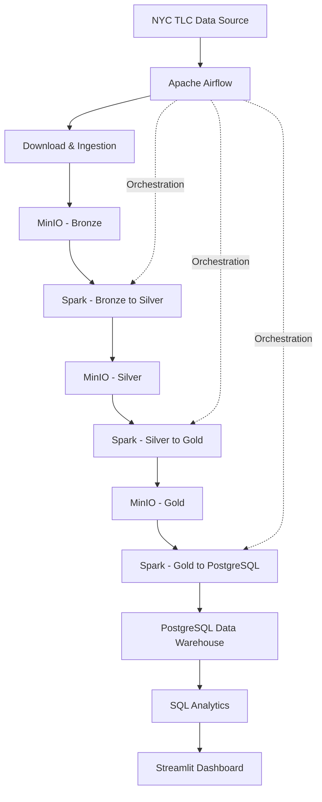
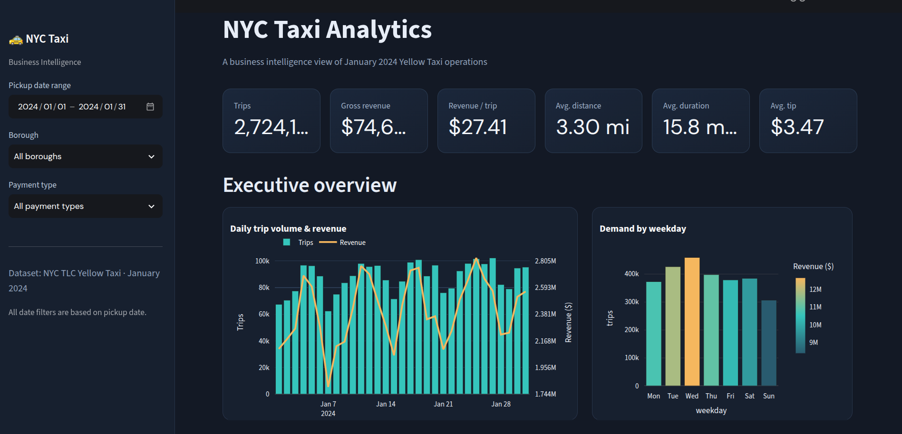
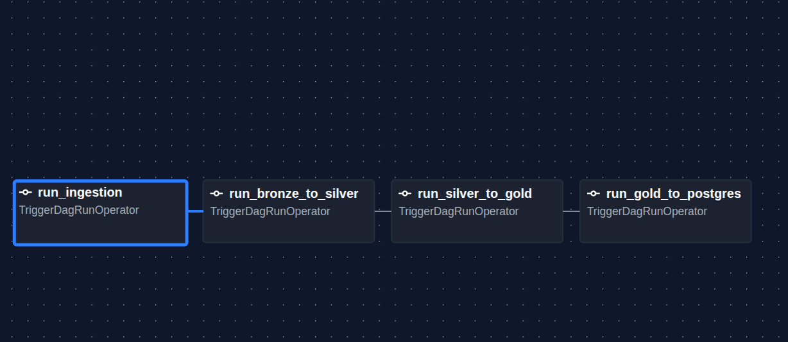
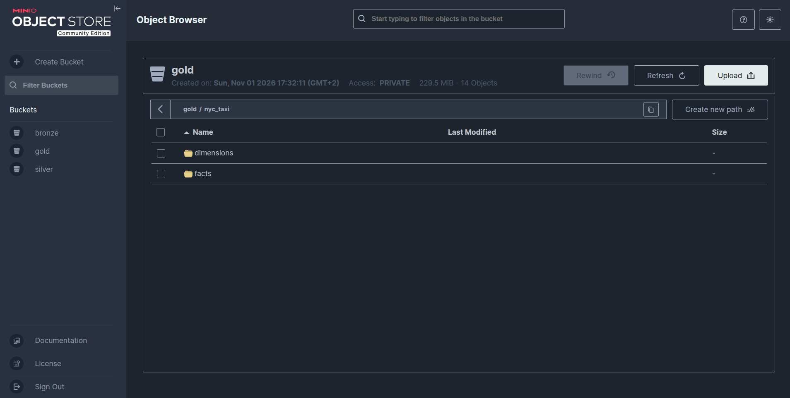
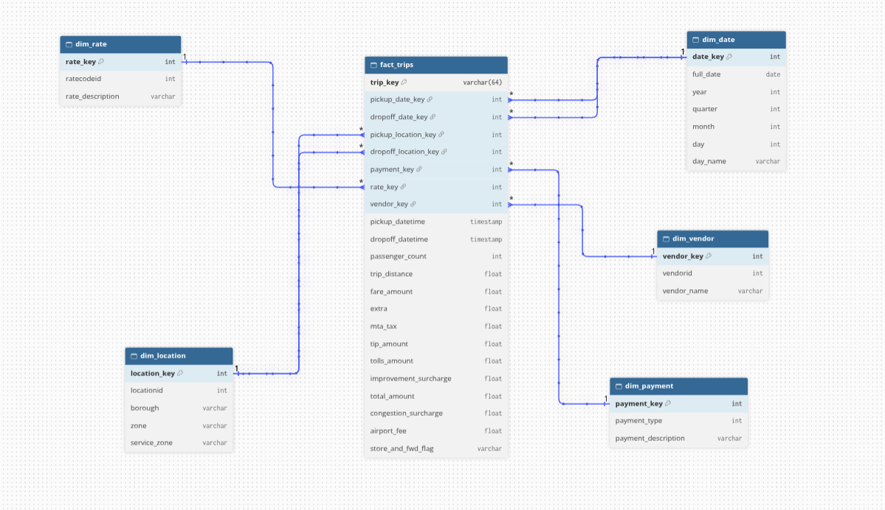

# NYC Taxi Data Engineering Pipeline

An end-to-end batch data engineering project that builds a data lake and analytical data warehouse using **Apache Spark, Apache Airflow, MinIO, and PostgreSQL**. The project processes NYC Yellow Taxi trip records through a Medallion Architecture, transforms raw data into a dimensional model, and delivers analytical insights through SQL and an interactive Streamlit dashboard.

## Project Overview

This project demonstrates a complete batch data engineering workflow, from source data ingestion to analytical reporting.

The pipeline downloads official NYC Yellow Taxi trip records and taxi zone reference data, stores the raw files in MinIO, processes and validates the data using Apache Spark, and builds a Star Schema in PostgreSQL.

Apache Airflow orchestrates the pipeline through a parent DAG and modular child DAGs, while a separate Streamlit application provides interactive business analytics.

## Architecture
## Pipeline Architecture




## Project Screenshots

### Streamlit Dashboard



### Airflow Pipeline Orchestration



### MinIO Data Lake



### Data Warehouse - Star Schema



## Technology Stack

| Technology | Purpose |
|---|---|
| Python | Pipeline development and data processing |
| Apache Airflow 3.3.2 | Workflow orchestration |
| Apache Spark 4.2.0 | Distributed data processing |
| MinIO | S3-compatible object storage |
| PostgreSQL 16 | Analytical data warehouse |
| Docker Compose | Containerized infrastructure |
| SQL | Data analysis and business queries |
| Streamlit | Interactive analytics dashboard |
| Plotly | Data visualization |

## Data Source

The project uses the official NYC Taxi & Limousine Commission (TLC) Yellow Taxi Trip Record data.

**Source:** [NYC TLC Trip Record Data](https://www.nyc.gov/site/tlc/about/tlc-trip-record-data.page)

Dataset used:

- Yellow Taxi Trip Records — January 2024.
- Taxi Zone Lookup — location reference data.

The trip records contain pickup and drop-off timestamps, location IDs, passenger counts, trip distances, payment types, fares, tips, and other trip-related attributes.

The January 2024 dataset contains approximately 2.7 million valid trips after cleaning and filtering.

## Data Lake — Medallion Architecture

MinIO is used as the data lake, with data organized into three layers.

### Bronze Layer

Stores the original source files with their raw structure.

- Yellow Taxi trip records in Parquet format.
- Taxi Zone Lookup in CSV format.
- Organized using logical source and date-based object paths.

### Silver Layer

Contains cleaned, standardized, and validated datasets.

Transformations include:

- Standardizing column names.
- Casting columns to appropriate data types.
- Removing records with missing critical fields.
- Filtering invalid trip distances, fares, passenger counts, and timestamps.
- Removing exact duplicate records.
- Restricting pickup dates to January 2024.
- Cleaning and validating taxi zone reference data.
- Checking unmatched pickup and drop-off location IDs.

Silver datasets are stored in Parquet format.

### Gold Layer

Contains analytics-ready dimensional datasets.

Spark transforms the Silver data into a Star Schema consisting of five dimensions and one fact table.

Gold datasets are stored as Parquet files in MinIO before being loaded into PostgreSQL.

## Data Warehouse — Star Schema

The PostgreSQL warehouse is designed for analytical queries and reporting.

### Dimension Tables

| Table | Description |
|---|---|
| `dim_date` | Calendar attributes for pickup and drop-off dates |
| `dim_location` | Taxi zones, boroughs, and service zones |
| `dim_payment` | Payment types and descriptions |
| `dim_rate` | Rate codes and descriptions |
| `dim_vendor` | Taxi vendor information |

### Fact Table

**`fact_trips`**

Contains trip-level measures and foreign keys referencing the dimensions.

Key attributes include:

- Trip key.
- Pickup and drop-off timestamps.
- Pickup and drop-off date keys.
- Pickup and drop-off location keys.
- Payment, rate, and vendor keys.
- Passenger count and trip distance.
- Fare, tips, tolls, taxes, and surcharges.
- Total trip amount.
- Store-and-forward flag.

The location dimension is used twice in the fact table to represent pickup and drop-off locations (role-playing dimension).

A deterministic SHA-256 hash is generated from the source trip attributes to provide a trip key because the original TLC dataset does not provide a unique trip identifier.

## Workflow Orchestration — Apache Airflow

Airflow manages the execution order of the pipeline through a parent DAG and modular child DAGs.

### Parent DAG

`nyc_taxi_parent`

Coordinates the pipeline workflow using `TriggerDagRunOperator`, waiting for each child DAG to finish successfully before triggering the next stage.

### Child DAGs

| DAG | Responsibility |
|---|---|
| `nyc_taxi_ingestion` | Downloads source data and uploads it to Bronze |
| `nyc_taxi_bronze_to_silver` | Executes the Bronze-to-Silver Spark job |
| `nyc_taxi_silver_to_gold` | Executes the Silver-to-Gold Spark job |
| `nyc_taxi_gold_to_postgres` | Loads Gold dimensional data into PostgreSQL |

Airflow uses `spark-submit` to submit jobs to the existing Spark standalone cluster.

## Data Validation

Data quality checks were performed throughout the pipeline.

Key validation results:

| Check | Result |
|---|---:|
| Silver trip records | 2,724,110 |
| Taxi zone records | 265 |
| Gold fact records | 2,724,110 |
| Unique trip keys | 2,724,110 |
| Null dimension foreign keys | 0 |
| Duplicate trip keys in PostgreSQL | 0 |
| Orphaned fact records | 0 |

The warehouse was also validated through SQL queries to confirm referential integrity and date ranges.

## Analytics & Dashboard

A separate analytics layer uses SQL and Streamlit to explore the PostgreSQL data warehouse.

The dashboard includes:

- Executive KPIs: total trips, revenue, average fare, and average trip distance.
- Daily revenue and trip trends.
- Demand patterns by weekday and hour.
- Borough and taxi zone analysis.
- Top pickup and drop-off zones.
- Payment method distribution.
- Revenue components and tipping behavior.
- Trip duration and distance analysis.
- Vendor performance comparison.

The dashboard supports interactive filtering by pickup date range, borough, and payment method.

## Project Structure

```text
NYC_Taxi_Pipeline/
│
├── airflow/
│   ├── dags/
│   │   ├── nyc_taxi_parent.py
│   │   ├── nyc_taxi_ingestion.py
│   │   ├── nyc_taxi_bronze_to_silver.py
│   │   ├── nyc_taxi_silver_to_gold.py
│   │   └── nyc_taxi_gold_to_postgres.py
│   ├── Dockerfile
│   ├── logs/
│   └── plugins/
│
├── data/
├── docs/
│   ├── airflow-dag.png
│   ├── dashboard.png
│   ├── minio-data-lake.png
│   └── star-schema.png
│
├── minio-data/
│
├── notebooks/
│
├── postgres/
│   └── init/
│       └── 01-create-warehouse.sql
│
├── spark/
│   └── jobs/
│       ├── bronze_exploration.py
│       ├── bronze_to_silver.py
│       ├── validate_silver.py
│       ├── silver_to_gold.py
│       └── gold_to_postgres.py
│
├── sql/
│   ├── 01_create_warehouse.sql
│   └── analysis/
│       ├── 01_executive_overview.sql
│       ├── 02_time_demand.sql
│       ├── 03_geographic_analysis.sql
│       ├── 04_revenue_payment.sql
│       ├── 05_trip_performance.sql
│       └── 06_vendor_analysis.sql
│
├── streamlit/
│   ├── app.py
│   └── requirements.txt
│
├── docker-compose.yml
├── .env.example
└── README.md
```

## Getting Started

### Prerequisites

- Docker Engine
- Docker Compose
- Git
- Python 3

### 1. Clone the Repository

```bash
git clone <YOUR_REPOSITORY_URL>
cd NYC_Taxi_Pipeline
```

### 2. Configure Environment Variables

Create your local environment file:

```bash
cp .env.example .env
```

Configure the required credentials in `.env`, including PostgreSQL, MinIO, and Airflow credentials.

Do not commit `.env` or expose credentials in the repository.

### 3. Start the Infrastructure

```bash
docker compose up -d --build
```

Check the running services:

```bash
docker compose ps
```

### 4. Access the Services

| Service | Local URL |
|---|---|
| Airflow | [http://localhost:8080](http://localhost:8080) |
| MinIO Console | [http://localhost:9003](http://localhost:9003) |
| Spark Master UI | [http://localhost:8081](http://localhost:8081) |
| Spark Worker UI | [http://localhost:8082](http://localhost:8082) |
| PostgreSQL | `localhost:5433` |

Use the credentials configured in your `.env` file.

### 5. Initialize the Warehouse

The `taxi_warehouse` database and its Star Schema tables must exist before loading Gold data.

The schema definition is available in:

```text
sql/01_create_warehouse.sql
```

If the warehouse tables have not already been created, initialize them using:

```bash
docker compose exec -T postgres \
  psql -U airflow -d taxi_warehouse \
  < sql/01_create_warehouse.sql
```

### 6. Run the Pipeline

Open the Airflow UI and locate:

```text
nyc_taxi_parent
```

Trigger the Parent DAG to execute the pipeline in sequence.

### 7. Run the Analytics Dashboard

Create and activate a Python virtual environment, then install the dashboard requirements:

```bash
cd streamlit

python3 -m venv .venv
source .venv/bin/activate

pip install -r requirements.txt
```

Configure the PostgreSQL connection using the `DATABASE_URL` environment variable expected by the dashboard.

The connection URL should follow this format:

```text
postgresql+psycopg://airflow:<POSTGRES_PASSWORD>@localhost:5433/taxi_warehouse
```

Replace `<POSTGRES_PASSWORD>` with the PostgreSQL password configured in your `.env` file.

Run the dashboard:

```bash
streamlit run app.py
```

The dashboard will be available at:

```text
http://localhost:8501
```

## Current Scope & Future Improvements

The current implementation is a batch pipeline designed around a January 2024 dataset and a full-refresh processing approach.

Potential future improvements include:

- Incremental data ingestion and processing.
- Idempotent PostgreSQL loading and safer retry handling.
- Automated data quality testing.
- Support for multiple months of TLC data.
- Slowly Changing Dimensions (SCD).
- Pipeline monitoring and alerting.
- CI/CD and automated deployment.
- Cloud deployment using Azure services.

## Key Takeaways

This project demonstrates practical experience with:

- Building batch ETL pipelines.
- Designing and implementing a Medallion Architecture.
- Distributed processing with Apache Spark.
- Object storage and S3-compatible systems.
- Dimensional modeling and Star Schema design.
- Workflow orchestration with Apache Airflow.
- PostgreSQL data warehousing.
- SQL-based analytical reporting.
- Containerization and multi-service infrastructure.

---

**Built with Python, Apache Spark, Apache Airflow, MinIO, PostgreSQL, Docker, and Streamlit.**
